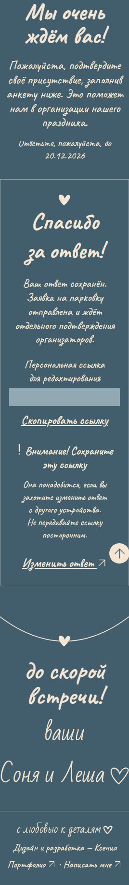
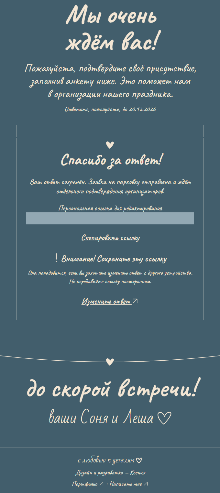

# Экран благодарности — ревью PR #8

Скриншоты настоящей формы после сохранения в локальный workerd/D1.
Персональная ссылка **полностью замаскирована**. Голубой прямоугольник —
только маска на снимке: новой плашки в интерфейсе нет.

## Мобильный viewport 320 px

## Десктопный viewport 1440 px

Проверены также ширины 375, 390, 430, 768 и 1024 px. Над карточкой нет
дублирующего успешного сообщения или пустого места от него. Подтверждение для
скринридеров остаётся в отдельной невидимой live-region. Восклицательный знак —
inline SVG с тем же кремовым currentColor, что и текст. Ошибка конфликта
сохраняет прежнее выравнивание.
Копирование и его fallback, редактирование, статусы парковки pending /
approved / rejected и отсутствие текста без запроса проверены браузерными
тестами. Повторить: `npm run test:rsvp`.
